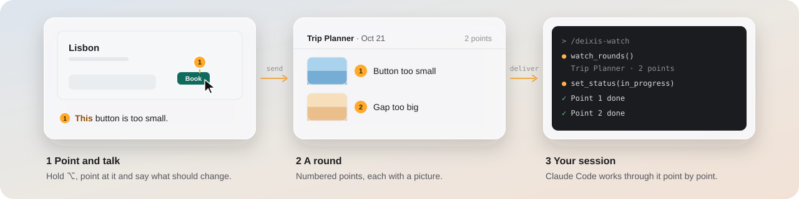

<div align="center">

<picture>
  <source media="(prefers-color-scheme: dark)" srcset="assets/banner-dark.svg">
  <source media="(prefers-color-scheme: light)" srcset="assets/banner-light.svg">
  
</picture>

<p>The Claude Code plugin for <a href="https://deixis.folnaro.app/en/">Deixis</a>, the Mac app for screenshot feedback.</p>

<p>


<a href="LICENSE"></a>
</p>

<p><a href="https://deixis.folnaro.app/en/">Website</a> · <a href="https://deixis.folnaro.app/en/support/">Support</a> · <a href="https://deixis.folnaro.app/en/privacy/">Privacy</a></p>

</div>

## Install

```sh
claude plugin marketplace add dnlbbrg/deixis-plugin
claude plugin install deixis@deixis
```

The plugin does not bring its own server. It starts the MCP helper that ships inside Deixis.app, so install the app first. The plugin looks for it in `/Applications`, then `~/Applications`, then wherever Spotlight finds it.

## How a round arrives

<picture>
  <source media="(prefers-color-scheme: dark)" srcset="assets/flow-dark.svg">
  <source media="(prefers-color-scheme: light)" srcset="assets/flow-light.svg">
  
</picture>

Hold right ⌥, point and talk. Each “this” or “here” becomes a numbered point with a picture, collected in a round. When you send the round to a session, it reaches Claude Code in one of two ways:

- **Right away**, if the session is running `/deixis-watch`. It waits for rounds and works through each one as it arrives.
- **With your next prompt** otherwise. The plugin adds the waiting rounds to the context of the next message you send.

While it works, Claude Code reports back per point: in progress, done with a short summary, or rejected with a reason. Questions go back to you as replies on the point.

## What you get

**MCP server `deixis`** with these tools:

| Tool | What it does |
|---|---|
| `list_rounds` | List recent review rounds, newest first. |
| `get_round` | Fetch a review round as Markdown. |
| `get_point` | Fetch one point, optionally with its image. |
| `get_round_overview` | One image of the whole round: every point's crop with its number, and a legend. |
| `watch_rounds` | Block until a round is sent to this session, then return it. |
| `reply` | Reply to the reviewer on a point (plain text, at most 2000 characters). |
| `set_status` | Set a point's status. `done` requires a summary, `rejected` requires a reason. |

The server also offers a resource and a prompt named `deixis`.

**`/deixis-watch`** waits for feedback rounds and works through each one as it arrives. The session stays busy until you press Esc.

**Session hooks**

| Hook | What it does |
|---|---|
| `SessionStart` | Tells Claude that Deixis is available and that `/deixis-watch` receives rounds as soon as they are sent. |
| `UserPromptSubmit` | Adds rounds waiting for this session to the context of your prompt. |
| `SessionEnd` | Lets Deixis know the session has ended. Prints nothing. |

The hooks never get in the way. If Deixis.app is not installed, they exit quietly and Claude Code works as before.

## Other agents

This repository is for Claude Code. Codex, Cursor, VS Code, Windsurf, Zed, JetBrains, Gemini CLI and Claude Desktop are set up from the settings of the Deixis app.

## Privacy

Deixis has no account, no server and no tracking.

- The MCP helper is a local process that talks to Claude Code over stdio. It makes no network connections and runs in the App Sandbox.
- Outside `/Applications`, the plugin only starts a copy of Deixis.app that is validly signed by the Deixis developer team, so an app that merely borrows the name is never run.
- Once a round is in your session, what Claude Code sends to its model provider is governed by Claude Code.

## Requirements

- macOS 26 or later
- [Deixis](https://deixis.folnaro.app/en/), coming soon to the Mac App Store
- Claude Code with plugin support

## License

The plugin in this repository (the launcher script, hooks, command and configuration) is released under the [MIT License](LICENSE). The Deixis app itself is not covered by this license.

<br>

<p align="center"><sub><a href="https://deixis.folnaro.app/en/">deixis.folnaro.app</a> · <a href="https://deixis.folnaro.app/en/support/">Support</a></sub></p>
